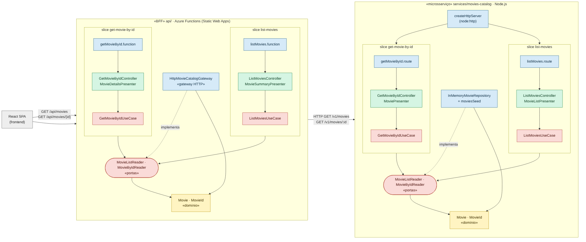

# BFF + Microsserviço — Vertical Slice, Clean Architecture e testes de arquitetura

O backend do MovieHub foi dividido em dois projetos independentes:

| Projeto | Pasta | Papel | Tecnologia |
|---|---|---|---|
| **BFF** (Backend for Frontend) | [`api/`](../../api) | Única porta de entrada do frontend. Recorta e adapta os dados do catálogo para as telas (lista resumida / detalhe), valida o id antes de chamar o serviço e devolve 502 amigável se ele cair. | Azure Functions v4 (Node.js, ES Modules), publicado no Azure Static Web Apps |
| **Microsserviço de catálogo** | [`services/movies-catalog/`](../../services/movies-catalog) | Dono dos dados de filmes. Expõe a API `v1` (`GET /v1/movies[?genre=]`, `GET /v1/movies/:id`, `GET /health`). | Node.js 22, `node:http` (sem framework) |

Os dois **não compartilham código**: cada um tem seu domínio, suas portas e seu kernel.
A comunicação é só por HTTP. O gateway do BFF funciona como camada anticorrupção,
convertendo o contrato do microsserviço (`{ items, total }`, `releaseYear`, `posterUrl`)
na entidade `Movie` do BFF (`year`, `poster`).



Fonte Mermaid: [`diagrama-bff-microsservicos.mmd`](diagrama-bff-microsservicos.mmd)

## Vertical Slice

Cada funcionalidade é uma pasta em `src/modules/<módulo>/features/<slice>` com tudo o que ela
precisa, da borda (Azure Function / rota HTTP) ao caso de uso:

```
api/src/modules/movies/features/                 services/movies-catalog/src/modules/catalog/features/
├── list-movies/                                 ├── list-movies/
│   ├── listMovies.function.js   (Azure)         │   ├── listMovies.route.js      (rota HTTP)
│   ├── listMovies.factory.js    (DI)            │   ├── listMovies.factory.js    (DI)
│   ├── ListMoviesController.js                  │   ├── ListMoviesController.js
│   ├── MovieSummaryPresenter.js                 │   ├── MovieListPresenter.js
│   └── ListMoviesUseCase.js                     │   └── ListMoviesUseCase.js
└── get-movie-by-id/                             └── get-movie-by-id/
    ├── getMovieById.function.js                     ├── getMovieById.route.js
    ├── getMovieById.factory.js                      ├── getMovieById.factory.js
    ├── GetMovieByIdController.js                    ├── GetMovieByIdController.js
    ├── MovieDetailsPresenter.js                     ├── MoviePresenter.js
    └── GetMovieByIdUseCase.js                       └── GetMovieByIdUseCase.js
```

Nova funcionalidade = nova pasta + uma linha no entry point (`api/src/index.js` ou
`services/movies-catalog/src/app.js`). Nenhuma slice existente é alterada.

## Clean Architecture — mapa de camadas

| Camada | BFF (`api/src`) | Microsserviço (`services/movies-catalog/src`) |
|---|---|---|
| **Entities** | `modules/movies/domain` (`Movie`, `MovieId`), `shared/domain/errors`, `shared/kernel` | `modules/catalog/domain` (`Movie`, `MovieId`), `shared/domain/errors`, `shared/kernel` |
| **Use Cases** | `*UseCase.js`, `modules/movies/application/ports` (`MovieListReader`, `MovieByIdReader`), `shared/application/errors` (`UpstreamServiceError`) | `*UseCase.js`, `modules/catalog/application/ports` |
| **Interface Adapters** | `*Controller.js`, `*Presenter.js`, `shared/http` (`errorMapper`, `httpResponses`) | `*Controller.js`, `*Presenter.js`, `shared/http` |
| **Frameworks & Drivers** | `*.function.js`, `shared/infrastructure/azure/azureHttpAdapter.js`, `modules/movies/infrastructure/gateways/HttpMovieCatalogGateway.js`, `*.factory.js`, `movies.container.js` | `shared/infrastructure/http/createHttpServer.js`, `*.route.js`, `modules/catalog/infrastructure/persistence/InMemoryMovieRepository.js`, `*.factory.js`, `catalog.container.js`, `app.js`, `main.js` |

As dependências sempre apontam para dentro. Os casos de uso dependem das **portas**;
quem implementa a porta é escolhido no composition root (`*.container.js`):
no BFF, o `HttpMovieCatalogGateway`; no microsserviço, o `InMemoryMovieRepository`.

## Testes de arquitetura (ArchUnitTS)

Arquivos: [`api/test/architecture/architecture.test.js`](../../api/test/architecture/architecture.test.js)
e [`services/movies-catalog/test/architecture/architecture.test.js`](../../services/movies-catalog/test/architecture/architecture.test.js).
O ArchUnitTS lê os `import` dos arquivos `.js` pelo compilador do TypeScript (`tsconfig.json` com `allowJs`),
por isso os dois projetos usam ES Modules.

| Grupo | Regra | BFF | Microsserviço |
|---|---|:-:|:-:|
| Regra da Dependência | Domínio não depende de nenhuma camada externa | ✔ | ✔ |
| | Application (portas) depende só do domínio | ✔ | ✔ |
| | Casos de uso dependem só de domínio + Application | ✔ | ✔ |
| | Casos de uso não conhecem controllers/presenters | ✔ | ✔ |
| | Casos de uso importam uma porta e nunca a infraestrutura concreta | ✔ | ✔ |
| | Controllers/presenters não dependem de infraestrutura nem da composição | ✔ | ✔ |
| | `shared/http` não depende de infraestrutura nem de slices | ✔ | ✔ |
| | Infraestrutura (gateway/repositório) não depende das slices | ✔ | ✔ |
| Vertical Slice | Cada slice não importa nenhuma outra (gerado para cada pasta de `features/`) | ✔ | ✔ |
| | Arquivos das slices seguem a convenção `*UseCase`, `*Controller`, `*Presenter`, `*.factory`, `*.function`/`*.route` | ✔ | ✔ |
| Bordas | Só `*.function.js` e o adapter do Azure importam `@azure/functions` | ✔ | — |
| | O BFF não tem persistência: `infrastructure/` só contém `*Gateway.js` | ✔ | — |
| | Só os gateways fazem chamadas de rede (`fetch`) | ✔ | — |
| | Só `shared/infrastructure/http` importa `node:http` | — | ✔ |
| | Repositórios ficam em `infrastructure/persistence` com nome `*Repository.js` | — | ✔ |
| | Domínio e casos de uso não usam `process.env`, `fetch` nem `console` | ✔ | ✔ |
| Grafo | Sem dependências cíclicas | ✔ | ✔ |
| | Sanidade: o grafo extraído tem as dependências esperadas (evita falso positivo) | ✔ | ✔ |

Como rodar:

```bash
cd services/movies-catalog && npm install && npm run test:arch
cd api && npm install && npm run test:arch
```
